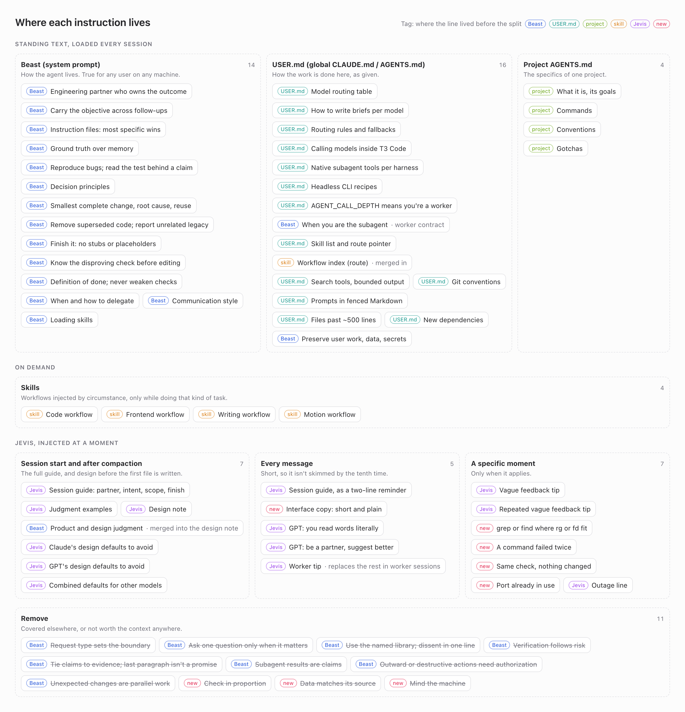

# Beast and Jevis

Beast and [Jevis](https://github.com/GLDRoger/jevis) are two separate repos I built for the same problem: keeping coding agents sharp without drowning them in walls of text.

| | Beast | Jevis |
|---|---|---|
| What it is | Instruction files and skills, symlinked into each harness | Hooks that fire at fixed moments during a session |
| What the agent sees | System prompt + `USER.md` at start; skill one-liners until loaded | Short tips at session start, every message, and specific tool moments; one end-of-turn check; optional design review |
| Harnesses | Claude Code, Codex, Grok, Gemini CLI, Antigravity, Muse Code, Hermes | Claude Code & Codex via installer; Gemini CLI, Antigravity & Muse Code by hand |
| Network / keys | None | None for tips; optional design review and custom lessons call a decision model |
| Uninstall | Manual ([Removing Beast](setup.md#removing-beast)) | `node bin/install.mjs --uninstall` |

Beast is the standing contract. Jevis repeats the handful of things agents forget mid-run, right when they're about to slip up.

## Using them alone or together

- **Beast only:** You get the system prompt, `USER.md`, and all skills across every harness. You skip the timed reminders and design tips (which live in Jevis's `nudges/` — I moved design reminders out of `BEAST.md`/`USER.md` because agents kept ignoring them there). Copy anything you want back into `USER.md`.
- **Jevis only:** Works with any `CLAUDE.md`/`AGENTS.md`. A couple of shipped tips reflect my setup (like `base-search.md` assuming `rg` and `fd` are installed). Override or disable any tip in `~/.jevis/nudges/` ([Jevis tips](https://github.com/GLDRoger/jevis/blob/main/docs/tips.md)).
- **Both:** Their installers don't collide. Beast links instructions and skills; Jevis adds hooks to `~/.claude/settings.json` and `~/.codex/hooks.json` (if you add Jevis's Gemini hooks by hand in `~/.gemini/settings.json`, merge them with Beast's `context.fileName`). They connect at one handoff: Beast's worker briefs open with `"You were called by another agent. Do this task yourself."` (or `AGENT_CALL_DEPTH`), which tells Jevis to treat the session as a worker and skip per-message tips, feedback tips, and design review.

### Quickest way to run both

1. Install Beast: `beast install --dry-run`, then `beast install` and `beast doctor` ([Setup](setup.md)).
2. Edit `home/shared/USER.md` for your setup ([Make it yours](setup.md#make-it-yours)).
3. Install Jevis with `--critic off` (zero API keys, zero network calls — just tips and the pass-claim check):
   ```sh
   git clone https://github.com/GLDRoger/jevis.git ~/code/jevis
   cd ~/code/jevis && npm install
   node bin/install.mjs --critic off --dry-run
   node bin/install.mjs --critic off
   node bin/jevis.mjs doctor
   ```
   Drop `--critic off` if you want the automated visual design review (needs a decision-model key, Chrome, and a signed-in `claude` or `codex` CLI).
4. Start a fresh session (`c`, `co`, etc.). Preview what a hook sends anytime:
   ```sh
   echo '{"session_id":"try","model":"gpt-6.2-sol"}' | node ~/code/jevis/bin/jevis.mjs hook session
   ```
5. Run it for a week or two and see if it actually cuts down corrections ([Judging it on your own work](https://github.com/GLDRoger/jevis/blob/main/docs/evidence.md#judging-it-on-your-own-work)).

## Where an instruction belongs

An agent reads from five layers. Each has one job. If a line doesn't pull its weight in any of them, delete it.

| Layer | Job | When it loads |
|---|---|---|
| `home/shared/BEAST.md` | How an agent works — universal engineering stance | Every session (system prompt) |
| `home/shared/USER.md` | How *I* work — model routing, briefs, skill map, permissions, git rules | Every session |
| Project `AGENTS.md` (`CLAUDE.md` is `@AGENTS.md`) | Repo-specific goals, commands, gotchas. No architecture summaries or file trees — the agent can read the repo. | Sessions in that repo |
| Skills (`home/agents/skills`, `skill-modules`) | Procedures needed only for one type of job | On demand |
| [Jevis](https://github.com/GLDRoger/jevis) tips | Short nudges injected at the exact moment they matter | Session start, per message, or trigger |

Two simple rules:
1. **Put each line at the narrowest scope where it's true.** Universal → Beast. My global rule → `USER.md`. One repo → `AGENTS.md`. One task type → skill. One moment or model family → Jevis tip. Nowhere → delete it.
2. **Repetition is intentional; contradiction is a bug.** A Jevis tip can echo a Beast/`USER.md` rule in fewer words, but the source file wins whenever they drift. Only session guides, judgment examples, design defaults, per-family nudges, and vague-feedback responses live exclusively in Jevis.

## The October 2026 sort

In October 2026 I went through every instruction line across my setup and placed each one in a single layer. The diagram below records that cleanup; use the table above as your working guide.

<picture>
  <source media="(prefers-color-scheme: dark)" srcset="media/layers-dark.png">
  
</picture>

Source: [`media/layers.html`](media/layers.html) (rebuild with `node docs/media/render-layers.mjs`).
