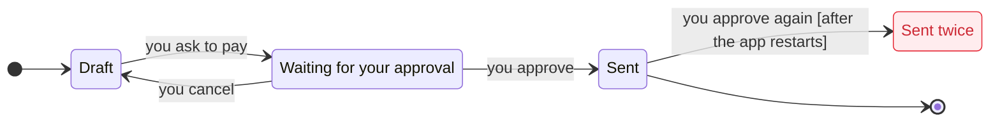

# Statecharts

A statechart shows how something moves between states, in the words of the person who decides whether that behaviour is right. Call that person the reader. The reader may never open the code. The chart, the bug paths beside it, and a capture or two are what they review.

## When to draw one

- A change alters how a flow behaves: draw it before and after.
- A bug is a sequence of steps: draw the path that reaches it.
- A model checker or property test ran over a flow: chart what it explored.
- Someone asks what can happen to a thing ("can an invoice go out twice?").

Skip it for a plain on/off switch or a single step. A table or one sentence is clearer there.

## Pick the source and say which

1. **A model checker's state graph.** Every arrow is one the model allows, and the checker has looked at every state within its bounds. It is only as true as the model, so name the model and its bounds.
2. **The code.** Read the status fields, enums, reducers, and state-machine definitions, every place that writes them, and the guards around those writes. Keep a note of the `file:line` behind each arrow; the note goes in the hand-off, not the chart. Say which arrows a test or a driver run exercises and which you only read.
3. **A spec or the reader's own words.** This is a proposal, not a description. Title it that way.

Put the source in the chart's title or the line under it: "From the TLA+ model at `a1b2c3d`, 2 accounts, 3 retries" or "Read from the code at `a1b2c3d`; arrows 2 and 5 are covered by tests."

## Words

- **States** name what the reader sees or cares about: "Waiting for your approval", "Sent", "Card declined, can retry". Keep variable names, enum values, and function names out. When the project has a glossary (`CONTEXT.md`), use its terms.
- **Arrows** say what happens, as the reader would put it: "you approve", "the bank declines", "an hour passes", "the app restarts". Never the handler or action name.
- A step that happens only under a condition ends with the condition in brackets, in the reader's words: "you approve [while offline]".
- Two code paths that look the same to the reader share one arrow and one label.
- One name per state across the chart, the bug paths, and the conversation.

## Keep it readable

Aim for about 20 arrows. Above that, the reader stops reading.

- Merge states that behave the same for the reader. Drop detail they don't need, such as a request in flight whose answer changes nothing.
- Never merge a bug away. Keep every state on a bug path, and keep two states apart when they break different rules.
- To hide an arrow that every state has (sign out, reload), keep every state reachable from the start and keep at least one way out of each state that has one. List the hidden arrows under the chart.
- When a flow has phases, draw one chart per phase, or use composite states, rather than one dense chart.
- A step that never leaves a state's label doesn't show. If the reader must see it, split the label.

## Mermaid



- Declare states with spaces as `state "Label" as Id`, and keep ids short and plain.
- `breaks` marks a state where a rule fails. `mayBreak` marks a merged state where only some of the states behind it fail. `changed` marks what a change added or altered in an after chart.
- `direction LR` reads better for long linear flows. Leave it out for branching ones.
- Avoid colons and semicolons inside labels; they end the label early in some renderers.

## Bugs as paths

For each rule that breaks, give the reader three things under the chart:

1. The rule as one sentence they agreed to: "A payment goes out at most once."
2. The shortest path to the break, as numbered steps in their words, from the start state to the marked state: "1. You ask to pay. 2. You approve. 3. The app restarts before it records the send. 4. You approve again. 5. The payment goes out twice."
3. The harm in one sentence.

When the path comes from a model, replay it against the real code before calling it a bug: a test or a live run with one step per arrow. If it doesn't reproduce, suspect the model first and say so.

## Before and after

For a change in behaviour, draw both charts with the same labels. In the after chart, mark added or altered states with `changed`. Under the charts, say in one or two sentences what changed for the reader ("Approving twice now shows 'Already sent' instead of paying again"). When the change is small, one chart with the changed parts marked is enough.

## From a TLA+ model

TLC can write the whole state graph it explored:

```sh
java -cp tla2tools.jar tlc2.TLC -dump dot,actionlabels graph.dot -continue -config Spec.cfg Spec.tla
```

- `graph.dot` has one node per state, labelled with the variable values, with initial states filled, and one edge per step, labelled with the action that took it.
- `-continue` keeps exploring after an invariant fails, so the graph shows the states after a bug. Bound the model (small constants or a `CONSTRAINT`) or it can run without end.
- `-dumpTrace json trace.json` writes each counterexample TLC finds as JSON.

Then write a small script in a scratch folder, outside the repo, that reads the graph and writes Mermaid. The judgment lives in three pure functions you write for this reader: state values to a state label, (action, before, after) to an arrow label, and a check of each agreed rule against a state's values to mark `breaks`. The script merges states with the same label, drops edges that stay inside one label, merges duplicate edges, and stops when a chart would pass the size budget. When the full graph is too large, chart only the paths to the broken rules.

Write the TLA+ actions as a disjunction of named steps (`Next == YouApprove \/ BankDeclines \/ AppRestarts`), so the edge labels are useful before you map them.

## Showing it

- In a client that renders Mermaid (T3 Code's chat does, on web and mobile), put the chart in a `mermaid` code block in the reply.
- Elsewhere, render it: an HTML page that loads Mermaid, opened in a browser or preview pane, or an SVG from a renderer the project already has. A new renderer is a new dependency; check need, provenance, and maintenance first.
- When the chart belongs to a PR or report, save the `.mmd` beside the other evidence and link it.

## Hand-off

- The chart, as Mermaid text.
- Its source, commit, and for a model, the bounds.
- One line per bug: the rule, the reader's sentence for it, and the numbered path.
- What the chart leaves out: hidden arrows, merged states, what the model or the code reading did not cover.
- How to make it again: the command, or the files you read.
